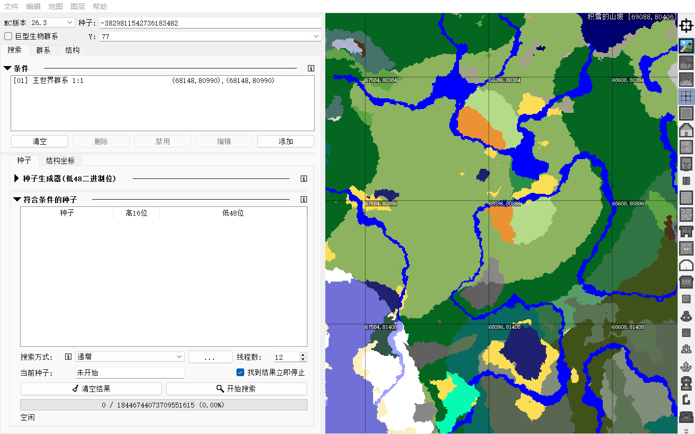

# Cubiomes Viewer Classic — Minecraft 26.3

An **unofficial backport** of Minecraft Java 26.3 support to the original
[Cubiomes Viewer 4.0.1](https://github.com/Cubitect/cubiomes-viewer/tree/4.0.1) interface,
using the updated [xpple/cubiomes](https://github.com/xpple/cubiomes) engine.

**保留 Cubiomes Viewer 4.0.1 原版界面，支持 Minecraft Java 26.3 看种与筛种。**
这是独立兼容分支，不是 Cubitect 官方版本。

## Download / 下载

- [Windows x64 portable package / Windows 免安装包](https://github.com/FredFive007/cubiomes-viewer-classic/releases/download/v4.0.1-mc26.3-classic1/Cubiomes-Viewer-26.3-Classic-4.0.1-Windows-x64.zip)
- [Release notes, source and checksums / 发布说明、源码和校验值](https://github.com/FredFive007/cubiomes-viewer-classic/releases/tag/v4.0.1-mc26.3-classic1)
- [中文使用与编译说明](CLASSIC-26.3.md)

Extract the **entire** archive, then run `cubiomes-viewer-26.3-classic.exe`.
Keep the adjacent DLLs and plugin folders. Java is not required. Choose **26.3** in the version dropdown.

解压全部文件后运行 EXE，保留旁边的 DLL 和文件夹；不需要安装 Java。
选择 **26.3**，继续使用原来的条件树和多线程搜索。



## Changes

- Original **19 UI forms and one stylesheet are byte-for-byte unchanged** from 4.0.1.
- Qt 5 controls; language, fonts, theme and icon size are inherited from an existing upstream installation on first normal launch.
- Minecraft 26.3 engine; Dappled Forest, Sulfur Caves, Pale Garden, Trial Chambers and Abandoned Camp entries.
- Updated structure and quad-seed-table interfaces, retaining the classic search workflow.
- Separate settings namespace.

This branch deliberately targets the old interface; it is not the upstream project's current development branch.

## Validation

Seven CTest suites passed locally, including engine checks and actual multithreaded Viewer searches.
**4,096 Overworld biome samples** matched Minecraft Java 26.3 across eight seeds,
four heights and block/quart sampling, including signed 64-bit boundary seeds.
New-biome inclusion/exclusion, camp counts, session round trips and classic quad-monument filtering passed.
The portable package was tested without the development toolchain on `PATH`.
Original UI hashes are in [validation/original-ui-sha256.json](validation/original-ui-sha256.json).

The first release is a **pre-release**. These are regression and sampled checks, not exhaustive validation
of every seed, dimension, structure or terrain feature. Structure predictions retain Cubiomes' approximations;
verify important seeds in-game.

## Build

Windows x64: CMake 3.21+, Ninja, Python 3, Qt 5.15.2 (`win64_mingw81`), MinGW 8.1.0.
The original executable used Qt 5.15.3; this build uses the public Qt 5.15.2 binaries.

```powershell
.\build-windows.ps1 -QtRoot 'C:\Qt\5.15.2\mingw81_64' -MinGwRoot 'C:\Qt\Tools\mingw810_64'
```

Use this CMake build. The historical qmake project is retained as upstream reference.
The engine is vendored in `cubiomes/`; no submodule checkout is required.
Only Windows has been validated for this branch.

## Credits and license

Original Viewer and Cubiomes author: **Cubitect**. Updated engine: **xpple and contributors**.
This fork maintains the compatibility integration and does not claim authorship of the upstream projects.

The Viewer retains [GPL-3.0](LICENSE); the engine retains [MIT](cubiomes/LICENSE), and Lua its original MIT notice.
Binary packages include dependency notices and corresponding Viewer/engine/Lua source.
See [SOURCE_PROVENANCE.md](SOURCE_PROVENANCE.md) and the preserved [upstream README](UPSTREAM_README.md).
